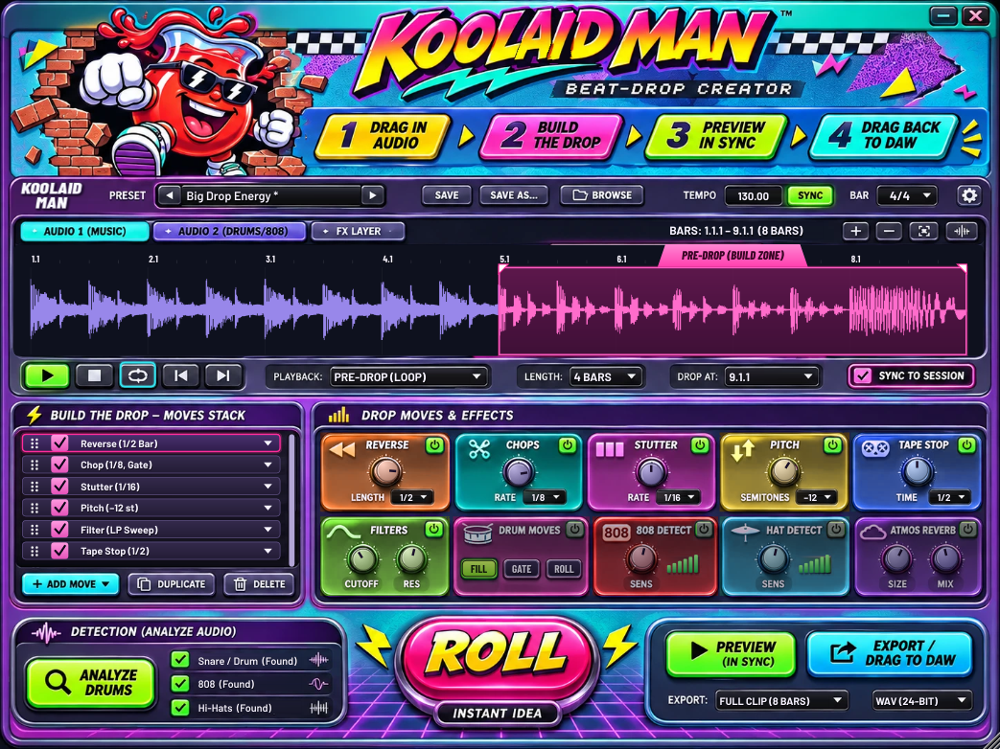
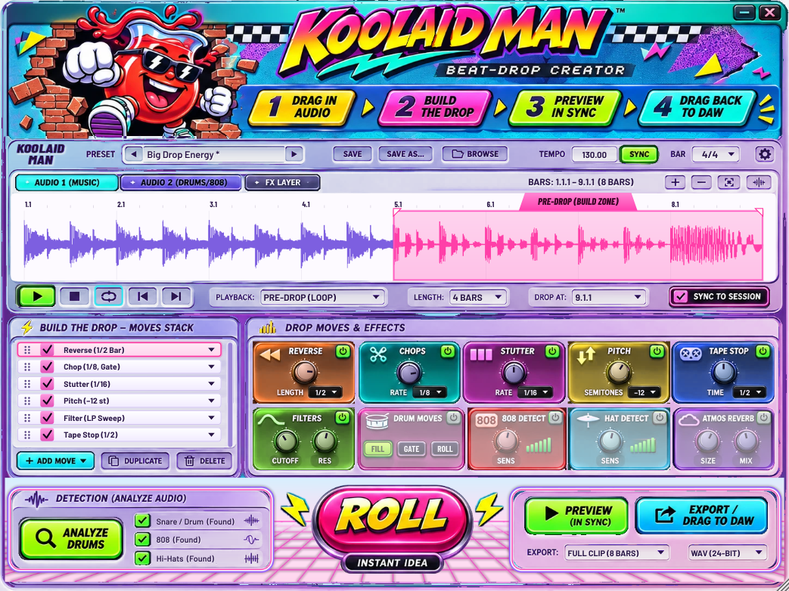
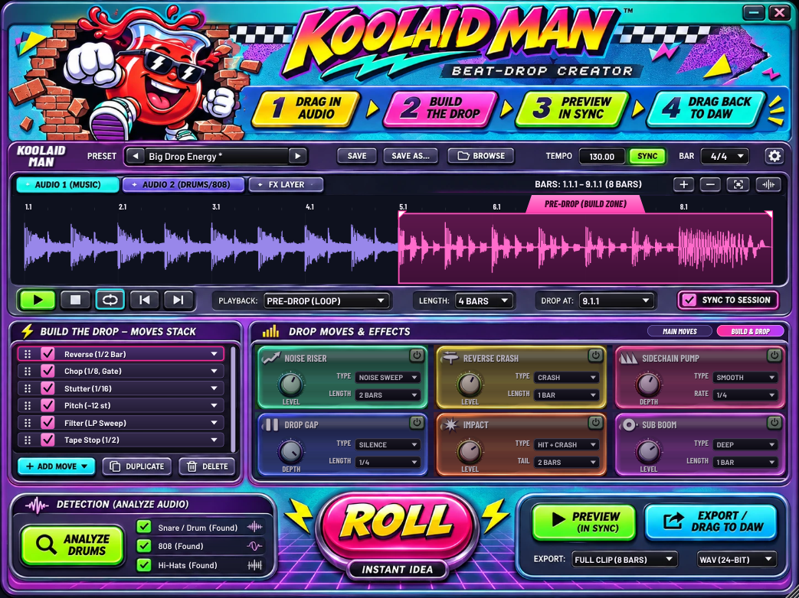
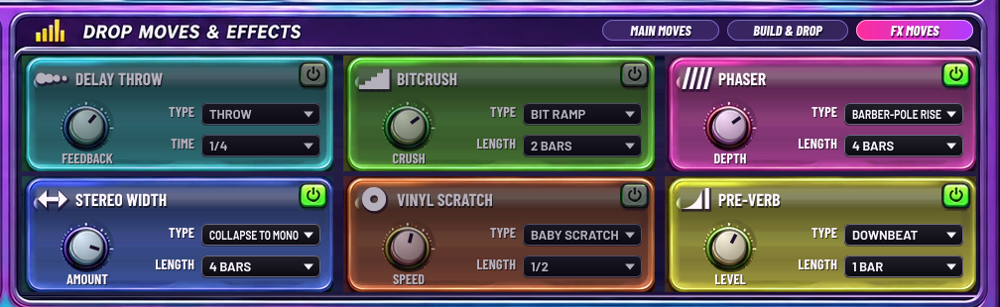
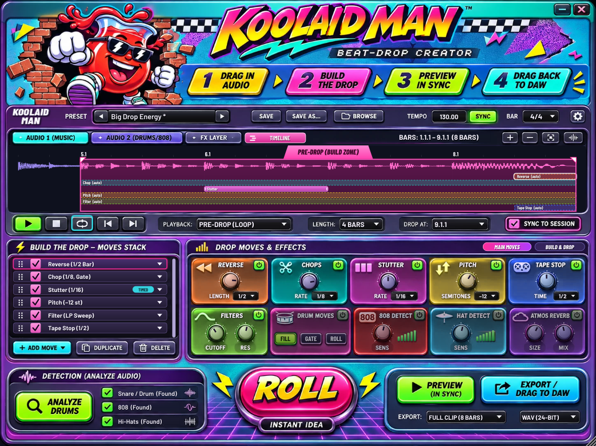

# Koolaid Man — Beat-Drop Creator

A beat-drop creator plug-in (VST3 / AU / Standalone) for producers working with two-tracks.
Drag in the bars before your drop, build the drop from a stack of moves — or hit **ROLL** for an
instant idea — preview it in time with your session, then drag the finished audio back into your
DAW. It's exactly bar-aligned, so it lands right on the grid.



**Light / dark:** click the Koolaid Man mascot (or gear menu > *Theme*) to switch to the light look:



Built for Cubase 14 Artist, and works in any DAW that loads VST3 (or AU on macOS).
Personal-use project.

**Manual:** built into the plug-in (gear menu > *Manual*, or click the small **KOOLAID MAN** label
next to PRESET). The same text is in [docs/MANUAL.md](docs/MANUAL.md).

## Get it

Every push builds the plug-in on GitHub Actions:

1. Open the repo's **Actions** tab → latest **Build Koolaid Man** run.
2. Download **KoolaidMan-Windows** (or **KoolaidMan-macOS**) under *Artifacts*.
3. Windows: easiest is **KoolaidMan-Windows-Installer** (run `KoolaidMan-Setup.exe`). Or copy the
   `Koolaid Man.vst3` folder from **KoolaidMan-Windows** to `C:\Program Files\Common Files\VST3\`.
   Then rescan in Cubase (*Studio → VST Plug-in Manager*). It's an insert effect under **Tools**.
   macOS: see `docs/INSTALL-MAC.txt`.

## Workflow (the four steps in the header)

| Step | What to do |
|---|---|
| **1 Drag in audio** | Drop a WAV/AIFF/FLAC/MP3 on the plug-in, click the empty waveform to load, or arm **CAPTURE** (the waveform button, top-right of the display) and press play in your DAW: it records the track from the next bar line until you stop, and remembers which bar it started on. Click the step-1 banner for all load options. |
| **2 Build the drop** | Drag the pink **PRE-DROP (BUILD ZONE)** handles (or use **LENGTH** / **DROP AT**). Turn moves on with the card power buttons, reorder the **MOVES STACK** by dragging, open a move's ▾ menu for its variations, or hit **ROLL**. |
| **3 Preview in sync** | With **SYNC TO SESSION** / **PREVIEW (IN SYNC)** lit, press play in the DAW: inside the clip's bars the track's audio is replaced by the drop, sample-accurate to the host position. The local transport (▶ ■ loop) auditions it without the DAW. |
| **4 Drag back to DAW** | Drag **EXPORT / DRAG TO DAW** (or the step-4 banner) into your project at the bar it tells you. Choose *Full clip*, *Build zone*, *Zone + drop* or *FX layer only*, as WAV 16/24/32-float or AIFF. Files are also saved to `Documents/Koolaid Man/Exports`. |

## The moves

| Card | Knob / value | Variations (card title or stack ▾ menu) |
|---|---|---|
| **Reverse** | Mix · Length | Into the drop, Pre-verse (plays the downbeat backwards into itself), Whole zone |
| **Chops** | Depth · Rate | Gate, Shuffle, Tremolo |
| **Stutter** | Span · Rate | Repeat, Accelerate, Beat repeat |
| **Pitch** | Curve · Semitones | Ramp (riser / dive), Static |
| **Tape Stop** | Brake · Time | Stop, Spin-up |
| **Filters** | Cutoff · Res | LP sweep, HP sweep, BP sweep, LP static, HP static |
| **Drum Moves** | FILL / GATE / ROLL | Snare fill (¼→⅛→1/16→1/32), gate to the found drum hits, snare roll |
| **808 Detect** | Sens (+ meter) | 808 slide down / slide up / sub swell, tuned to the 808 found in your audio |
| **Hat Detect** | Sens (+ meter) | Hat roll, triplet roll, open hats, using your clip's hats |
| **Atmos Reverb** | Size · Mix | Hall, Cathedral, Shimmer, Cloud, Plate, Deep Space, Reverse Swell |

**BUILD & DROP** page (tabs in the cards panel's title bar):



| Card | Knob / value | Variations |
|---|---|---|
| **Noise Riser** | Level · Length | Noise Sweep, Uplifter, Snare Wash |
| **Reverse Crash** | Level · Length | Crash, Splash, Dark Wash |
| **Sidechain Pump** | Depth · Rate | Smooth, Hard, Rising, Follow Kick |
| **Drop Gap** | Depth · Length | Silence, Low-pass, High-pass |
| **Impact** | Level · Tail | Hit + Crash, Hit Only, Crash + Downlifter (plays on the drop) |
| **Sub Boom** | Level · Length | Deep, Punchy, Long Dive (plays on the drop) |

Riser, Reverse Crash, Impact and Sub Boom can use **your own sample** (drag a file onto the card): risers end on
the drop, crashes are reversed into it, impacts hit on the downbeat. Samples are saved inside the project.

**FX MOVES** page:



| Card | Knob / value | Variations |
|---|---|---|
| **Delay Throw** | Feedback · Time | Throw (track drops out under the echoes), Ping-Pong Build, Tape Echo |
| **Bitcrush** | Crush · Length | Bit Ramp, Downsample, Full Crush |
| **Phaser** | Depth · Length | Barber-Pole Rise (endlessly rising), Phaser Sweep, Flanger |
| **Stereo Width** | Amount · Length | Collapse To Mono, Widen Out, Mono Snap |
| **Vinyl Scratch** | Speed · Length | Baby Scratch, Rewind, Brake |
| **Pre-Verb** | Level · Length | Downbeat, Drop Bar, Snare (the drop's own hit, reverb-swelled in reverse) |

**Workflow:** undo/redo (stack title bar), A/B compare of two versions, an automatable
**Build Amount** parameter (0% = original, 100% = full drop, live), and stem export (music + FX).

**Timeline:** the TIMELINE tab shows one lane per move; drag lanes to choose exactly when each
move happens (double-click for auto).



**Detection** finds the snare, 808/kick and hi-hats in the two-track (or in an optional drum/808
stem on the **AUDIO 2** tab) and uses those exact hits for the drum moves. Anything it can't find
falls back to a built-in sound. The **FX LAYER** tab shows just what the moves add.

Presets: 67 factory presets in 9 genres (Classic, Trap, Drill, Hip-Hop, EDM, House, Bass, Pop, Chill);
**SAVE / SAVE AS / BROWSE** store your own in `Documents/Koolaid Man/Presets`. Right-click **ROLL** to roll
in a genre's style, and lock moves you want ROLL to keep.
Everything (audio included) is saved with your DAW project.

## Build from source

Requires CMake ≥ 3.24 and a C++17 compiler. JUCE 8 is downloaded automatically.

```bash
cmake -S . -B build -DCMAKE_BUILD_TYPE=Release
```

```bash
cmake --build build --config Release --target KoolaidMan_VST3 KoolaidMan_Standalone
```

Add `-DKOOLAID_BUILD_TESTS=ON` to also build the engine tests, the VST3 host test and the UI
snapshot tool (see `.github/workflows/build.yml` for how they're run).

## Notes

- UI art: your mockup (`resources/skin.png`) with the title spelling fixed to **KOOLAID MAN** and
  the effect cards recolored; every value, knob, list and waveform on top of it is live.
- Fonts: Barlow / Barlow Condensed (SIL Open Font License, `resources/fonts/OFL.txt`).
- Pitch shifting: [Signalsmith Stretch](https://github.com/Signalsmith-Audio/signalsmith-stretch) (MIT).
- Built with [JUCE](https://juce.com). "Kool-Aid Man" is a trademark of its owner. This project is
  for personal, non-commercial use only.
